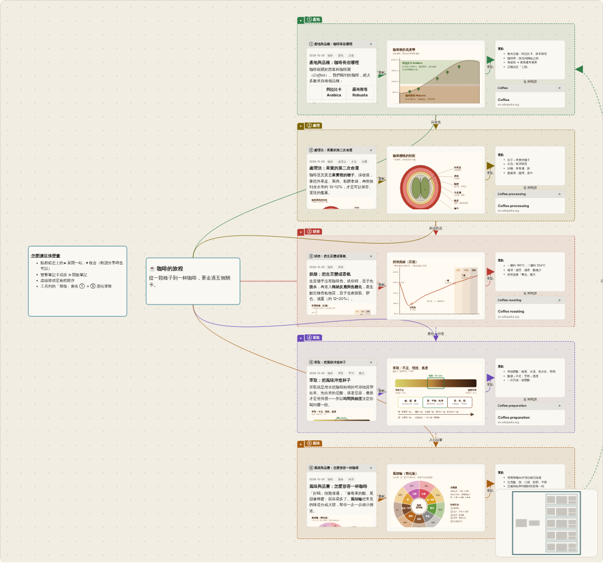

# 範例：「咖啡的旅程」互動壁畫

一個完整的主題範例：**5 篇筆記（Markdown）＋ 5 張 SVG 簡圖 ＋ 連結卡片 ＋ 連線 ＋ 可收合的群組**，排成右展開的心智圖。

## 怎麼用
- **匯入**：Vault 的「備份」頁 →「匯入備份」→ 選 `coffee-journey-mural.zip`。會建立新的私人主題 `coffee-journey`，不會動到既有內容。
- **互動**：第一站預設展開，其他收合成小方塊；點群組左上的 ▸／▾ 展開或收合（唯讀訪客也可以）。「簡報」會依 ① → ⑤ 逐站導覽。
- 筆記沒有單獨設定 `public`，跟著主題走：主題改為公開，整張壁畫就一起公開。

## 設計重點（給 AI 工程師）
- 檔案格式就是備份 ZIP：`notes/<id>.md`、`assets/<id>.svg`、`topics/<id>.json`、`boards/<topic>.canvas.json`、`manifest.json`。id 格式 `YYYYMMDD-短碼`，筆記 front matter 的 `id` 必須與檔名一致。
- 筆記之間用 `[[id]]` 連結；筆記內嵌圖用 ``。
- 群組由上到下排列，所以「簡報」模式（依 y→x 排序）的順序就是旅程順序。
- 群組收合時會縮成**左上角的小方塊**（220×56），所以把群組排成一欄，收合後就是整齊的目錄。
- 連結卡片的 `x-preview` 只放確定的標題與網站名，不編造摘要。
- `generator/` 是產生這份 ZIP 的 Python 腳本（`python3 build.py out.zip`；加 `--expanded` 產生全展開版），可當作「讓 AI 產生壁畫」的範本。
- 測試：`frontend/tests/example_mural.test.js` 會真的匯入這個 ZIP 並檢查畫布。
